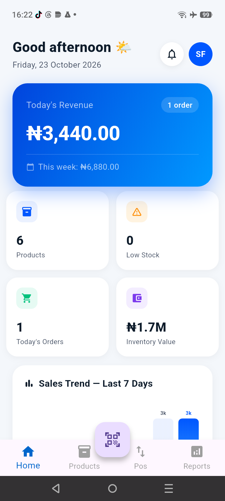

# stockflow

> A cross-platform mobile inventory management app built for small and medium businesses — replacing paper-based stock tracking with a real-time, role-based mobile solution.


---

## Problem

Most small warehouses, retail shops, and manufacturers in Nigeria track inventory on paper or basic Excel spreadsheets. This leads to stockouts, overstocking, zero team visibility, and wasted time reconciling records manually.

**StockFlow solves this** by giving businesses a mobile-first inventory system their whole team can use in real time.

---

## Screenshots

### Homepage


### Label Generator


### Product page


### Reports page


### Scan page


---

## Features

- 📊 **Live Dashboard** — real-time stock stats, inventory value, low stock alerts, and bar charts
- 📦 **Product Management** — add/edit/delete products with barcode scanning and photo upload
- 🔄 **Stock Movements** — record stock in/out with reasons, full audit trail, atomic transactions
- 📈 **Reports** — pie charts, 7-day line charts, PDF and CSV export with date range filter


---

## Tech Stack

| Layer | Technology |
|---|---|
| Framework | Flutter + Dart |
| State Management | Riverpod 2.0 |
| Navigation | GoRouter |
| Backend | Firebase (Auth + Firestore + Storage) |
| Charts | FL Chart |
| Export | pdf + csv + share_plus |
| Barcode Scanner | mobile_scanner |
| Notifications | flutter_local_notifications |

---

## Architecture

```
lib/
├── core/               # Constants, theme, utility functions
├── models/             # UserModel, ProductModel, TransactionModel
├── services/           # AuthService, ProductService, ReportService, NotificationService
├── providers/          # Riverpod providers (auth, products, transactions, search)
├── screens/
│   ├── auth/           # Splash, Login
│   ├── dashboard/      # Dashboard with charts and alerts
│   ├── products/       # Product list, detail, add/edit
│   ├── transactions/   # Stock in/out, movement history
│   ├── reports/        # Charts and export
│   └── settings/       # Profile, user management
├── widgets/            # Reusable UI components
├── router.dart         # GoRouter with auth redirect guard
└── main.dart           # Firebase init + ProviderScope
```

**Key design decisions:**
- Firestore **transactions** (atomic writes) ensure stock quantity and movement log never get out of sync
- Riverpod **StreamProviders** keep the UI reactive to live Firestore changes
- Transactions are **immutable** — once written, they cannot be updated or deleted (full audit trail)

---

## Getting Started

### Prerequisites
- Flutter SDK 3.x
- Android Studio or VS Code

### 1. Clone the repo

```bash
git clone https://github.com/Eddtn/stockflow.git
cd stockflow
flutter pub get
```


### 4. Run the app

```bash
flutter run
```

---

## Business Impact

This app targets small businesses that currently manage stock manually. Key value propositions:

- Eliminates stockout surprises with real-time low stock notifications
- Gives managers full audit trail of every stock movement and who made it
- Enables remote visibility — managers can check stock from anywhere
- Reduces reconciliation time from hours to seconds with PDF/CSV export

---

## Roadmap

- [ ] Multi-location/warehouse support
- [ ] Supplier management module
- [ ] Purchase order generation
- [ ] Barcode label printing
- [ ] WhatsApp notification integration
- [ ] Offline mode with sync

---

## Author

**Eddieton** — Industrial Engineer + Flutter Developer  
[GitHub](https://github.com/Eddtn) · [LinkedIn](#) · [Email](#)

---

## License

MIT — feel free to use this as a reference or starting point for your own projects.
"# stickflow_app" 
